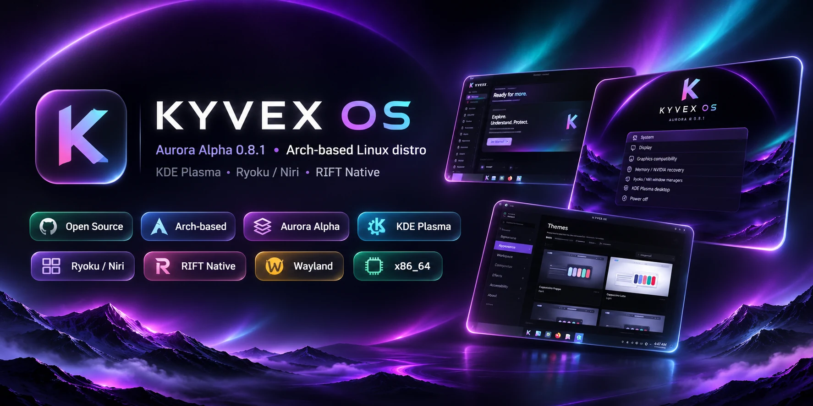
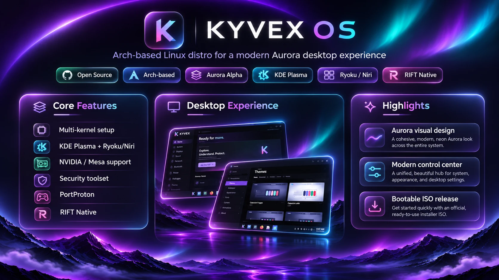
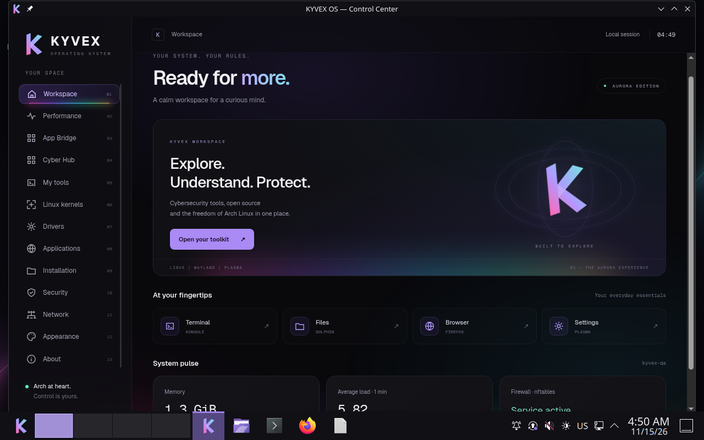
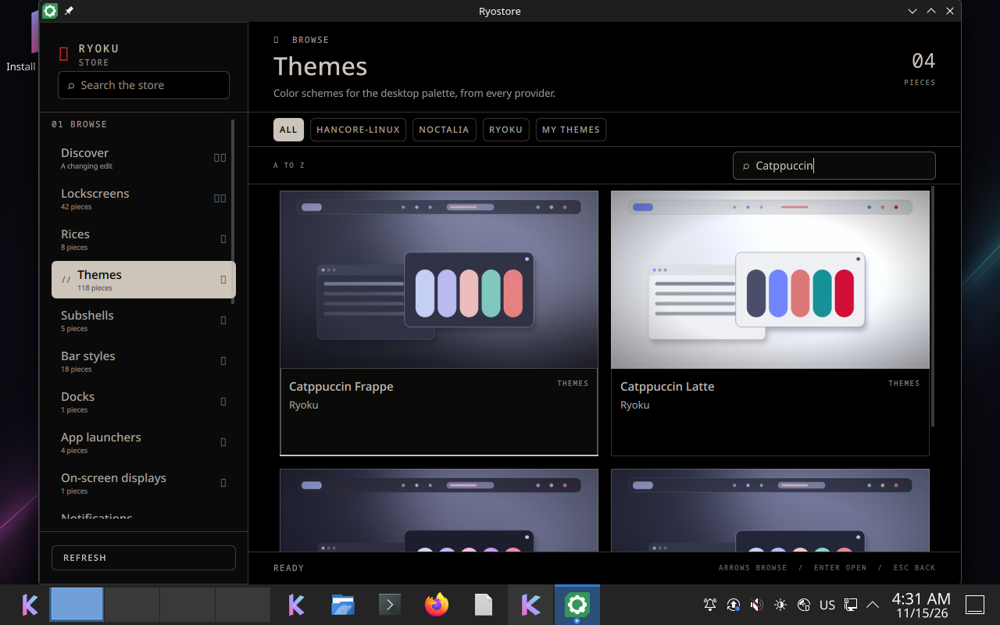
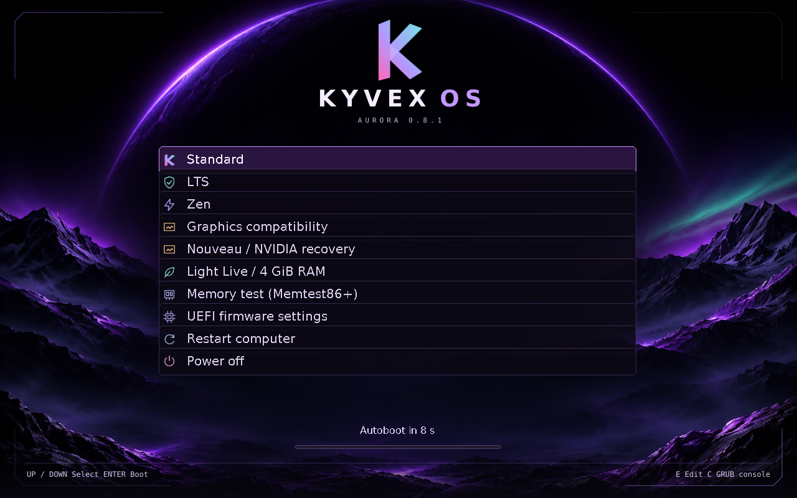
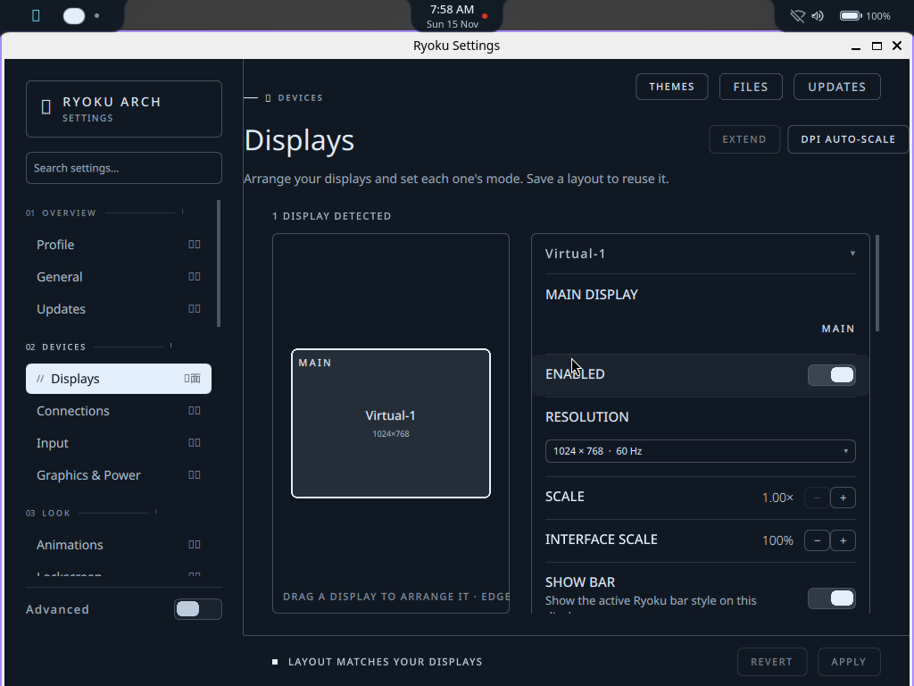
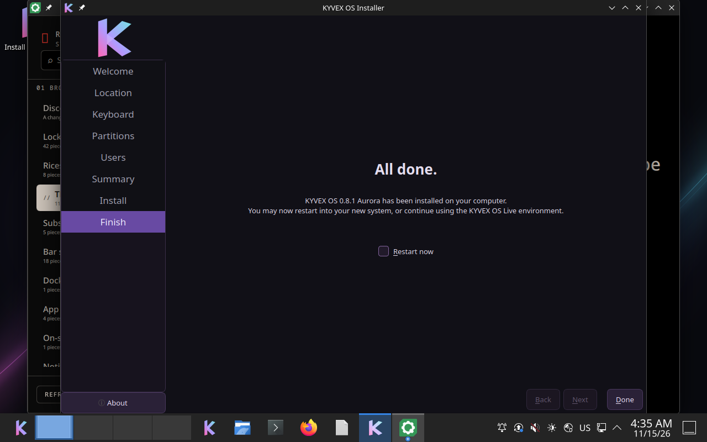
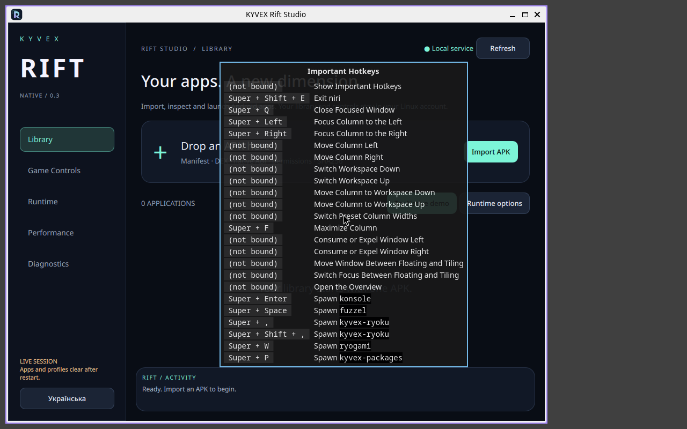
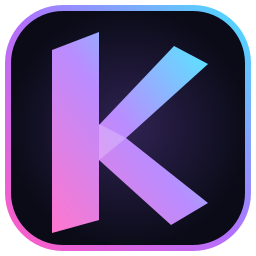

<div align="center">

<a href="#kyvex-os"></a>

<br />

<h1 id="kyvex-os">KYVEX OS</h1>
Site: https://ashen-six-86.vercel.app
<h3>The Aurora desktop. Reimagined for Linux.</h3>

<p><strong>An experimental Arch Linux-based x86-64 distribution built around a cohesive Aurora interface, streamlined management and developer-friendly tools.</strong></p>

<a href="#release-status"></a>
<a href="#architecture"></a>
<a href="#desktop-experience"></a>
<a href="#desktop-experience"></a>
<a href="#rift-native"></a>

<a href="#licensing"></a>
<a href="#features"></a>
<a href="#system-requirements"></a>
<a href="#features"></a>
<a href="#architecture"></a>

**[Explore screenshots](#desktop-experience)** · **[Features](#features)** · **[Installation](#installation)** · **[Source & development](#for-developers)** · **[Release status](#release-status)**

<sub>Design concept & adaptation: <a href="https://github.com/gtausa197-svg">gtausa197-svg</a> · Visual lineage: DuoDesk Aurora → TwinDesk · GPL-3.0 source; third-party terms apply.</sub>

</div>

---

## ✦ Welcome to Aurora

KYVEX OS brings several everyday Linux workflows into one environment: a themed **KDE Plasma 6.8.2** desktop, optional **Ryoku / Niri** and **Xfce** sessions, a KYVEX Control Center, Arch package sources, driver management, and an experimental Android APK runtime called **RIFT Native**.

This repository contains the **actual 0.8.1 Alpha source snapshot** you provided: system configuration, ArchISO files, desktop code, installer integration, Rust RIFT sources, tests, development scripts and attributed upstream dependencies. The screenshots below are **real captures from the supplied VM validation archive**.

> [!IMPORTANT]
> **Alpha software.** KYVEX OS 0.8.1 is intended for evaluation and development. Some functions were tested in virtual machines, but real-hardware compatibility—including RTX 5070, external displays, and suspend/resume—is not yet verified here. Do not treat this source snapshot as a certified production OS.

## ✨ Features

| Aurora desktop & system | Software & compatibility |
|:---|:---|
| **🪐 Aurora desktop** — GRUB, boot visuals, Plasma theming and lock-screen styling. | **🛡️ Audit-ready utilities** — Wireshark, Nmap, tcpdump, YARA, Sleuth Kit, and Kali/Parrot integration via Distrobox. |
| **🧭 KYVEX Control Center** — System information, packages, kernels, drivers, performance and appearance. | **🎮 Windows applications** — PortProton 1.7.5 with bundled starter runners; app compatibility varies. |
| **⚙️ Three kernels** — Standard **7.3.4**, **6.18.63 LTS**, and **7.3.4 Zen** in the documented Alpha image. | **🧬 RIFT Native** — Experimental Rust APK runtime with Dynarmic and Qt/QML; partial Android API support. |

<div align="center"><br /><sub>Promotional concept art; real validation screenshots are shown below.</sub></div>

## 🖥️ Desktop experience

**Actual VM captures** from the provided `validation(1).7z` archive. Click an image to view it at full resolution.

| KYVEX Control Center | RyoStore themes |
|:---:|:---:|
| [](assets/screenshots/installed-desktop.png) | [](assets/screenshots/ryostore-catppuccin-results.png) |
| **Live GRUB Aurora** | **Ryoku / Niri settings** |
| [](assets/screenshots/grub-release-uefi.png) | [](assets/screenshots/niri-palette-and-display.png) |
| **Calamares installer** | **RIFT Native Studio** |
| [](assets/screenshots/installer-finished.png) | [](assets/screenshots/release-ryoku-niri.png) |

<details><summary><b>More validation screenshots</b></summary>

- [Plasma display settings](assets/screenshots/plasma-display-settings.png)
- [Ryoku settings](assets/screenshots/ryoku-settings-live.png)
- [Installed login screen](assets/screenshots/installed-default-plasma.png)
- [Installer progress](assets/screenshots/installer-progress-later.png)
- [ADW palette application](assets/screenshots/ryostore-adw-applied.png)
- [Catppuccin Frappé palette](assets/screenshots/ryostore-frappe-applied.png)

</details>

## 🧩 Architecture

<div align="center">

`Arch Linux` → `KYVEX system integration` → `KDE Plasma / Ryoku-Niri / Xfce`  
`pacman + Yay + Flatpak` · `Distrobox / Podman` · `PortProton` · `RIFT Native`

</div>

| Component | Release snapshot |
|:---|:---|
| Base / architecture | Arch Linux, x86-64 |
| Desktop | KDE Plasma 6.8.2 (Wayland); Ryoku/Niri and Xfce (X11) optional |
| Installation | Calamares 3.4.3 with local SquashFS deployment |
| Linux kernels | Standard 7.3.4 · LTS 6.18.63 · Zen 7.3.4 |
| Graphics stack | Mesa (AMD/Intel) · NVIDIA Open 620.70.06 in the release manifest |
| Packages | Arch repos · AUR/Yay · signed Ryoku repo · Flathub; Kali/Parrot via Distrobox |
| Windows | PortProton 1.7.5 |
| Android experiment | RIFT Native 0.3.0, Rust + Dynarmic + Qt/QML |
| Storage security | Optional LUKS2 root encryption in installer |

Read the [source architecture guide](docs/ARCHITECTURE.md) and original [BUILD-MANIFEST.json](BUILD-MANIFEST.json).

## 🧬 RIFT Native

RIFT is **not Waydroid** and does not depend on a full Android system image in the documented 0.8.1 configuration. It provides an experimental execution path for selected APK/DEX/ARM components, with its own partial Android API and JNI implementations.

- Runtime code: [`rift/`](rift/)
- Detailed implementation notes: [`rift/README.md`](rift/README.md)
- Architecture: [`rift/NATIVE-DESIGN.md`](rift/NATIVE-DESIGN.md)
- ARM JIT: upstream **Dynarmic**, appropriately credited in [`THIRD_PARTY.md`](THIRD_PARTY.md)

> [!CAUTION]
> **RIFT Native is experimental.** Bundled demos and API subset tests are not evidence that commercial Android games or arbitrary apps work. Do not execute untrusted APKs under the assumption that the runtime is a security-certified sandbox.

## 🚀 Installation

> **The source package does not contain the approximately 6.7 GiB installation ISO.** No public ISO URL is asserted by this README. The maintainer must publish a separately verified release before the download link can be added.

1. Obtain the official **KYVEX OS 0.8.1 x86-64 ISO** from a release source you trust once published.
2. **Verify its SHA-256 against that exact published image.** Conflicting candidate hashes were present in the supplied release notes and checksum file; see [Release integrity](docs/RELEASE-INTEGRITY.md).
3. Write the USB image with **Rufus → DD Image mode** (or a suitable raw-image writer).
4. Boot in **UEFI** or legacy **BIOS**, then launch **Install KYVEX OS** from the live desktop.
5. Use **Calamares** to select partitions and optional LUKS2 root encryption. Back up your disk first.

See the full [Installation guide](docs/INSTALLATION.md) and [hardware/testing limitations](docs/KNOWN-LIMITATIONS.md).

### System requirements

| | Installer minimum | Practical recommendation |
|:---|:---|:---|
| CPU | x86-64 | Modern x86-64, hardware virtualization if testing VMs |
| RAM | 3 GiB reported installer threshold | 8 GiB or more for a comfortable Plasma live session |
| Disk | 24 GiB reported installer threshold | 40–64 GiB or more to allow updates and extra tools |
| Boot | BIOS or UEFI | UEFI preferred; Secure Boot requires separate configuration |

## 🧪 Release status

<div align="center">


</div>

- **Confirmed from supplied materials:** Hybrid BIOS/UEFI media layout; VM screenshots and logs of GRUB, installation and KDE login; Ryoku palette/display tests; package list and source files.
- **Reported by prior release notes:** 56 automated tests; the uploaded evidence is not a complete independently rerun test suite.
- **Still pending:** Real RTX 5070 and multi-monitor validation, wider hardware support, full RIFT app compatibility, and a public verifiable ISO download.

See [Known limitations](docs/KNOWN-LIMITATIONS.md), [Roadmap](docs/ROADMAP.md), [packaging verification](docs/VERIFICATION.md), and [release-checklist](docs/RELEASE-CHECKLIST.md).

## 🧑‍💻 For developers

```bash
git clone https://github.com/gtausa197-svg/KYVEX-OS.git
cd KYVEX-OS
python3 tools/check_repository.py
```

> The clone URL above becomes functional **only after you create/publish** the repository at that address. `tools/check_repository.py` validates documentation assets; it does **not** build or test the OS.

| Source area | Contents |
|:---|:---|
| [`archiso/`](archiso/) | Live ISO profile, overlays, GRUB and installed system integration |
| [`desktop/`](desktop/) | KYVEX Control Center, Aurora assets, Electron UI |
| [`installer/`](installer/) | Installer integration |
| [`rift/`](rift/) | RIFT Native Rust implementation and testing fixtures |
| [`scripts/`](scripts/) | Build and image preparation scripts |
| [`tests/`](tests/) | Existing project tests |
| [`vendor/`](vendor/) | Third-party pinned sources and licenses |
| [`docs/`](docs/) | English GitHub-facing documentation |
| [`assets/`](assets/) | Authentic screenshots, icons, banners and SVG badges |

**Building the ISO is a staged developer workflow**, not a single standalone command. See [Build from source](docs/BUILD-FROM-SOURCE.md). Also read [Source package notes](docs/SOURCE-PACKAGE.md) before relying on a fresh build.

## 🤝 Community & contributions

Contributions are welcome in graphics compatibility, documentation, QA, Ryoku integration, Calamares verification, and RIFT Native tests. Start with [CONTRIBUTING.md](CONTRIBUTING.md), the [issue templates](.github/ISSUE_TEMPLATE/) and [SECURITY.md](SECURITY.md).

## ⚖️ Licensing

KYVEX OS source is distributed under **GPL-3.0** (see [LICENSE](LICENSE)); the included third-party components and artworks may carry their own licenses. **DuoDesk Aurora** is attributed to **0xCodez**, based on **TwinDesk** by **inukaasith**. **Dynarmic** is upstream software, not original KYVEX implementation. Consult [THIRD_PARTY.md](THIRD_PARTY.md) before redistribution.

---

<div align="center">



### KYVEX OS · Aurora Alpha 0.8.1

*Explore. Understand. Protect.*

<sub>Built on Arch Linux · Designed by <a href="https://github.com/gtausa197-svg">gtausa197-svg</a> · Experimental open-source distribution</sub>

</div>
